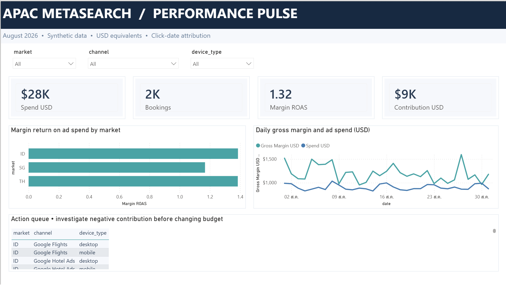
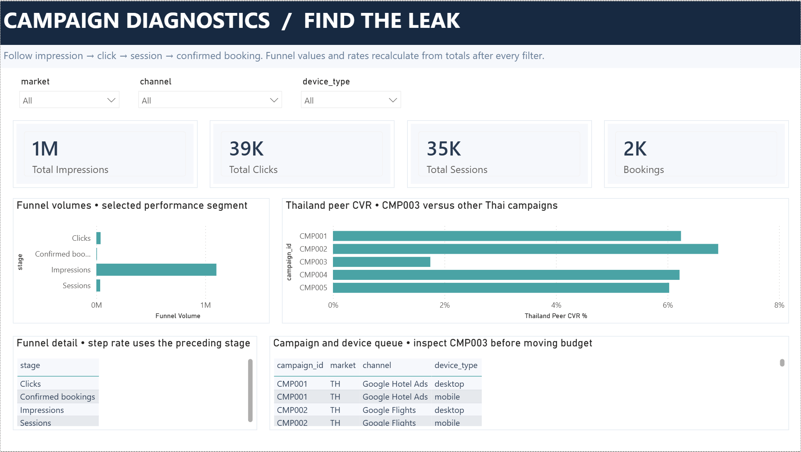
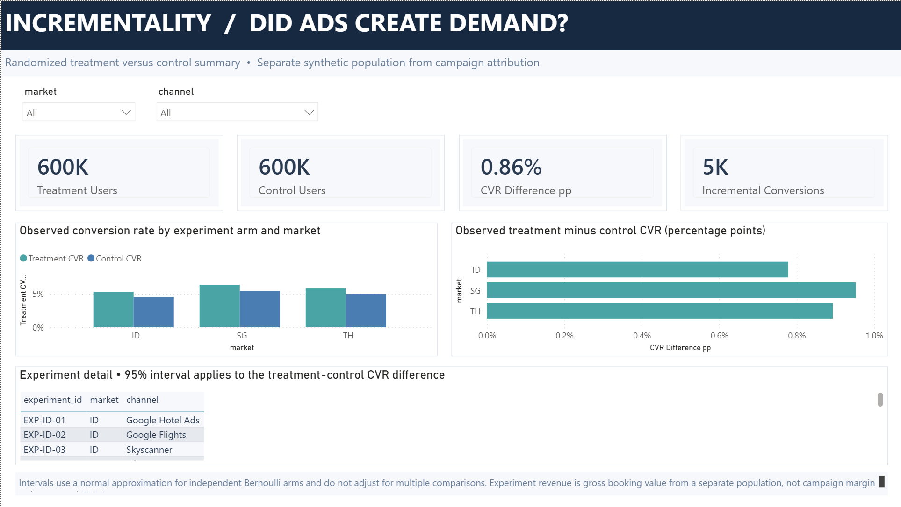
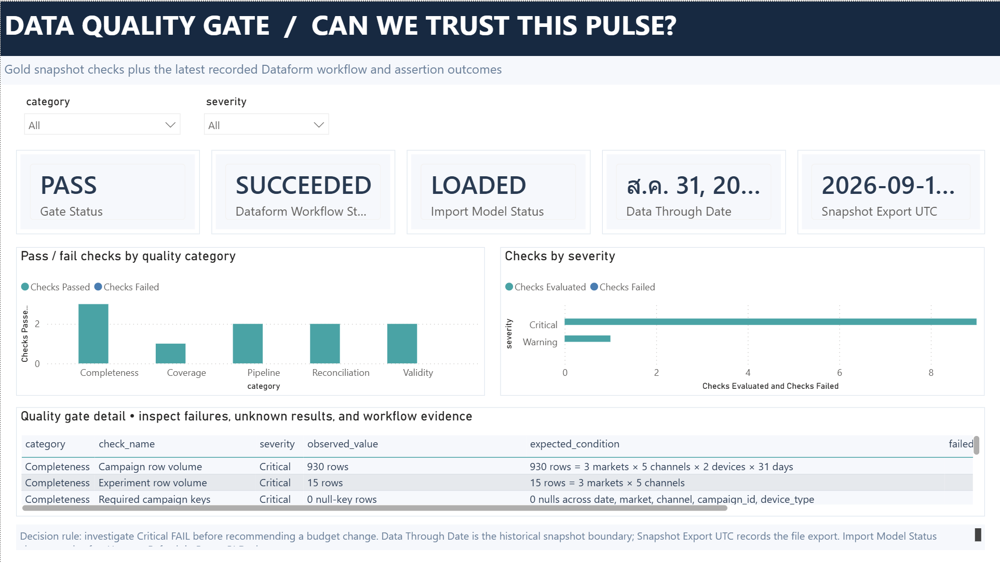

# APAC Metasearch Performance Analytics

An interview practice project for a Senior Analyst, Digital Marketing role in travel. **Every record is synthetic**; the data and findings do not describe Traveloka, its users, or its campaigns.

## Business objective

A travel marketplace buys traffic from several metasearch channels across Thailand, Indonesia, and Singapore. The analyst's job is to decide where advertising spend deserves investigation or investment while protecting gross margin. That requires linking platform activity to first-party bookings, checking whether the data is trustworthy, and measuring demand caused by ads separately from bookings attributed to ads.

| # | Business question | Evidence this project provides |
|---:|---|---|
| 1 | Which markets, channels, and devices earn enough margin to justify spend? | Campaign daily spend, confirmed paid bookings, gross margin, and margin return on ad spend (Margin ROAS). |
| 2 | Where does the customer journey weaken? | Impression → click → session → booking funnel and a deliberately weak campaign, `CMP003`. |
| 3 | Did ads create additional bookings? | Separate randomized Treatment/Control experiment with user-level assignments and outcomes. |
| 4 | Can the team trust the numbers before changing budget? | Dataform quality assertions and a Power BI Data Quality Gate page. |

The scope is August 2026, three markets, five metasearch channels, and mobile/desktop. The outputs are two BigQuery Gold marts and a four-page Power BI Desktop report.

An example investigation is `CMP003` (Thailand Skyscanner): it attracted 4,925 clicks but produced 86 confirmed paid bookings, a 1.75% click-to-booking conversion rate (CVR), and USD −2,808.86 contribution after spend. The practical next step is to inspect its offer, landing experience, and device mix before changing budget.

## Report preview

### 1. Executive Pulse — where should we investigate spend?



### 2. Funnel and Campaign Diagnostics — where is the leak?



### 3. Incrementality — did ads create demand?



**Screenshot note:** This captured page shows 600K users per arm and 5K incremental conversions. The checked-in Gold snapshot has **75,000 users per arm and 656 incremental conversions**. The cause of the displayed difference is still being investigated; use the [Gold snapshot](bi/snapshot/gold_incrementality_experiment.csv) for numerical analysis until the Desktop model is reconciled. See the [report guide](docs/report.md#screenshot-reconciliation-issue-to-resolve).

### 4. Data Quality Gate — can we trust the snapshot?



## How the project works

```text
Six linked synthetic CSV sources
    → BigQuery Bronze (source-shaped tables)
    → Dataform Silver (typed and checked data)
    → Dataform Gold (Campaign Daily + Incrementality Experiment)
    → Power BI Desktop (Import snapshots and DAX measures)
```

The campaign mart connects ad platform performance, clicks, first-party sessions, and bookings. The experiment mart connects assigned users to their outcomes in a separate population. Upstream Dataform assertions prevent a Gold rebuild when relevant data quality checks fail. The [lineage diagram](assets/gold-data-lineage.svg) and [data model guide](docs/data-model.md) explain the joins and metric definitions.

## Last verified data snapshot

Verified in BigQuery on 2026-09-20 (Asia/Bangkok); this is a static practice snapshot, not a live feed.

| # | Result | Value |
|---:|---|---:|
| 1 | Campaign clicks → attributed sessions → confirmed paid bookings | 39,171 → 35,377 → 1,792 |
| 2 | Ad spend → gross margin → contribution after spend | USD 28,062.17 → USD 37,081.33 → USD 9,019.16 |
| 3 | Margin return on ad spend (Margin ROAS) | 1.32× |
| 4 | Experiment result across 15 tests | 656 incremental conversions; USD 145,309.26 incremental booking revenue |
| 5 | Dataform workflow | 31 successful actions, including 23 assertions; zero failed or skipped |

The experiment result is from a separate synthetic population and must not be added to campaign bookings or margin. See the [verified run details](docs/operations.md).

## Explore or run the project

| # | Open | What you will find |
|---:|---|---|
| 1 | [Data model and measurement logic](docs/data-model.md) | Six source tables, join grains, Bronze → Silver → Gold lineage, quality dependencies, and full key performance indicator (KPI) definitions. |
| 2 | [Power BI report guide](docs/report.md) | Page design, semantic model, Data Analysis Expressions (DAX), Tabular Model Definition Language (TMDL), data quality page, and known screenshot issue. |
| 3 | [Runbook and progress log](docs/operations.md) | BigQuery/Dataform links, copy-ready queries, deployment and refresh commands, verified counts, and handoff for Codex or Claude Code. |
| 4 | [Power BI Desktop project](bi/APAC_Metasearch_Analytics/APAC_Metasearch_Analytics.pbip) | Open locally and use **Home > Refresh** to load the CSV Import snapshots. |
| 5 | [BigQuery Gold dataset](https://console.cloud.google.com/bigquery?project=bq-dataform-sg&d=apac_meta_gold&page=dataset) | The two KPI-ready marts behind the report. |

To validate the checked-in generated data locally, run `python generate_data.py --validate-only` from this repository. The [runbook](docs/operations.md#validate-and-rebuild) covers a full warehouse rebuild and Power BI refresh.

## Project status

The synthetic data, BigQuery/Dataform transformations, quality gate, and four report pages are built. The next work is to reconcile the Incrementality page's displayed totals, analyze `CMP003` and the experiment, and write the final interview decision narrative. The [progress log](docs/operations.md#progress-log) records completed steps and the next action.
