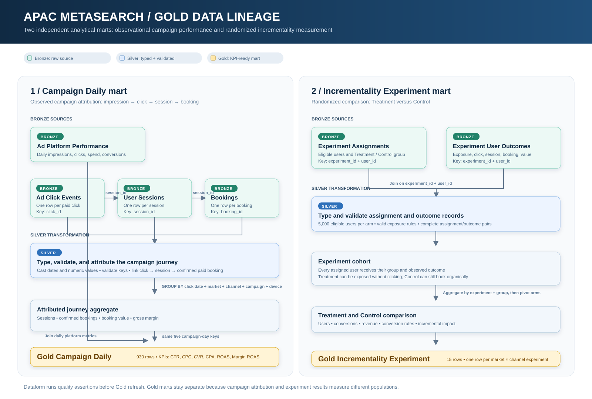

# APAC Metasearch Performance Analytics

Interview practice project for a Senior Analyst, Digital Marketing role in travel. All records are **synthetic** and do not represent Traveloka, its users, or its actual campaigns.

## Objective and workflow

Follow `impression → ad click → first-party session → booking → revenue / margin`, then compare observational marketing KPIs with a separate randomized incrementality experiment.

## Gold data lineage



The diagram is a GitHub-ready summary of how the six Bronze sources pass through Silver transformations into the two independent Gold marts. It is a learning aid; the Dataform SQLX definitions remain the executable source of truth.

| # | Stage | Status | Deliverable |
|---:|---|---|---|
| 1 | Generate linked synthetic data | Complete | Six CSV tables in [`data/`](data/) and deterministic [`generate_data.py`](generate_data.py) |
| 2 | Load to BigQuery and build ELT model | Complete | BigQuery Bronze/Silver/Gold datasets, Dataform SQL and quality gates |
| 3 | Analyze campaign, market, and device performance | Next | Findings and CMP003 investigation |
| 4 | Analyze experiment | In progress | User-level treatment/control outcomes, incremental conversions, relative lift, uncertainty, decision caveats |
| 5 | Build dashboard and interview case narrative | In progress | Four-page Power BI report; action narrative and rendered review remain |

## Data contract

| # | CSV / grain | Key and joins | Notes |
|---:|---|---|---|
| 1 | [`ad_platform_performance.csv`](data/ad_platform_performance.csv) — date × market × channel × campaign × device | `campaign_id` plus date/market/channel/device to click events | Includes impressions, clicks, USD ad spend, confirmed paid conversions. |
| 2 | [`ad_click_events.csv`](data/ad_click_events.csv) — one ad click | `click_id`; nullable `session_id` to sessions | A click may bounce before a session. A user can click repeatedly across sessions. |
| 3 | [`user_sessions.csv`](data/user_sessions.csv) — one session | `session_id`; `user_id` to bookings | Includes paid metasearch and organic sessions. |
| 4 | [`bookings.csv`](data/bookings.csv) — one booking | `booking_id`; `session_id` to sessions | Confirmed/paid, cancelled/refunded, and pending states. Booking can occur up to 72 hours after session. |
| 5 | [`experiment_assignments.csv`](data/experiment_assignments.csv) — experiment × eligible user | `experiment_id`, `user_id` | Random Treatment/Control assignment; the experiment denominator. |
| 6 | [`experiment_user_outcomes.csv`](data/experiment_user_outcomes.csv) — experiment × user | `experiment_id`, `user_id`; optional click/session/booking IDs | User-level test exposure, optional journey, and booking outcome. It is isolated from campaign attribution. |

The generator covers **2026-08-01 to 2026-08-31** across Thailand (`TH`), Indonesia (`ID`), Singapore (`SG`), five metasearch channels, and mobile/desktop. Campaigns `CMP001`–`CMP015` are each tied to one market and channel. All monetary columns (`ad_spend`, `booking_value`, `gross_margin`, experiment booking outcomes) are synthetic **USD equivalents**; `commission_rate` is a fraction. `gross_margin` is booking value × commission rate for confirmed paid bookings, before ad spend. Cancelled and pending bookings have zero realized margin.

### User-level experiment lineage

The experiment is intentionally isolated from the observational campaign-attribution population, so adding it cannot change campaign clicks, sessions, bookings, or Power BI campaign KPIs. There are 15 experiments, each with 5,000 assigned users per arm. The user-level tables make the causal calculation inspectable without treating an advertising click as the experiment denominator:

```text
experiment_assignments (experiment_id, user_id, Treatment / Control)
        ↓ left join on experiment_id + user_id
experiment_user_outcomes (optional test click, session, confirmed paid booking)
        ↓ aggregate by experiment_id + group
gold_incrementality_experiment (same 15-row schema consumed by Power BI)
```

Treatment assignment is an intent-to-treat population: a Treatment user can have no click and remains in the denominator. A Control user can have an organic/direct session and booking but has no test-ad click. The Gold experiment mart counts confirmed paid bookings and booking value after assignment, then compares Treatment and Control conversion rates. `click_id` is retained as delivery/journey evidence; it is not the key used to define experiment eligibility or causal impact.

## Implemented BigQuery ELT architecture

The local Python generator remains the synthetic source. Load its six CSV files into BigQuery Bronze tables, preserving source values. Perform transformations in BigQuery using Dataform SQLX, with versioned definitions and dependencies:

| # | Layer | Implemented content and gate |
|---:|---|---|
| 1 | Bronze | Six source-shaped tables, load metadata, row-count and schema checks. |
| 2 | Silver | Typed timestamps/numerics, standardized statuses, paid-click/session/booking attribution, experiment assignment/outcome records, and explicit handling for unmatched clicks and organic sessions; assertions for unique keys, references, valid ranges, temporal order, experiment arms, assignment/outcome integrity, and platform reconciliation. |
| 3 | Gold | Campaign × click date × market × channel × device KPI mart plus an experiment mart derived from assigned users and their outcomes; assert mart grain, nonnegative metrics, and reconciliation to Silver. |

Gold actions explicitly depend on upstream Dataform assertions, so a failed gate skips Gold refresh. The experiment mart is separate from observational attribution. The workflow has been run successfully by manual invocation; no recurring schedule is configured because the current source is a static CSV snapshot.

### Deployed resources and runbook

| # | Resource | Value |
|---:|---|---|
| 1 | GCP project / region | `bq-dataform-sg` / `asia-southeast1` (Singapore) |
| 2 | BigQuery datasets | `apac_meta_bronze`, `apac_meta_silver`, `apac_meta_gold`, `apac_meta_assertions` |
| 3 | Dataform repository / workspace | `apac-metasearch-performance` / `development` |
| 4 | Dataform runner | `apac-metasearch-dataform@bq-dataform-sg.iam.gserviceaccount.com`; dataset-scoped read on Bronze, write on Silver/Gold/assertions, project-scoped BigQuery Job User |
| 5 | Local deployment files | [`load_bronze.py`](load_bronze.py), [`dataform/cloud_api.py`](dataform/cloud_api.py), [`dataform/definitions/`](dataform/definitions/) |

[Open this GCP project in BigQuery](https://console.cloud.google.com/bigquery?project=bq-dataform-sg). The active `gcloud` default project on this computer was **not** `bq-dataform-sg` when this project was deployed. Always specify the project explicitly in cloud commands; do not change or use another GCP project by accident.

With an authenticated Google Cloud CLI and BigQuery CLI, rerun the snapshot and transformation from this directory:

```powershell
python generate_data.py
python load_bronze.py
python dataform/cloud_api.py sync
python dataform/cloud_api.py run
python dataform/cloud_api.py status
```

`run` starts an asynchronous Dataform invocation. Repeat `status` until it reports `SUCCEEDED`; an in-progress invocation reports `RUNNING`. The `grant-access` action in `cloud_api.py` is a one-time dataset access setup for the already created runner. `load_bronze.py` replaces only the six active Bronze tables and removes the explicitly retired aggregate experiment table after a successful complete load. Dataform rebuilds its dedicated Silver and Gold tables.

The local [`dataform/`](dataform/) files are the source of truth for SQL and workflow settings. `sync` **overwrites matching files in the cloud Dataform development workspace** with these local files and removes the two retired aggregate-experiment definitions; cloud-only edits should be copied back here before running it. The Dataform repository is not connected to an external Git remote. The project Git repository tracks local code, SQLX, documentation, and the six synthetic CSV files. The latest invocation name is also saved locally in `dataform/.last_invocation.json`, which is ignored by Git.

### Verified cloud snapshot (2026-09-20, Asia/Bangkok)

| # | Check | Result |
|---:|---|---|
| 1 | Bronze row counts | 930 platform rows; 39,171 clicks; 36,792 sessions; 2,034 bookings; 150,000 experiment assignments; 150,000 user outcomes. Loader checked each cloud count against its CSV. |
| 2 | Dataform execution | Latest invocation `1789905980-ef8a4782-fceb-4dbf-8e8e-c75ce1e89ab6` in `SUCCEEDED` state; 31 actions, including 23 assertions, with zero failed/skipped. |
| 3 | Gold campaign mart | 930 rows; 39,171 clicks; 35,377 attributed sessions; 1,792 confirmed paid conversions; USD 28,062.17 ad spend; USD 296,589.98 booking value; USD 37,081.33 gross margin. |
| 4 | Gold experiment mart | 15 experiments, each with 5,000 assigned users in each arm; 656 incremental conversions and USD 145,309.26 incremental revenue from user-level outcomes. Do not add these figures to observational campaign totals. |

The first Dataform execution caught 28 booking-margin rounding mismatches and skipped Gold as designed. [`generate_data.py`](generate_data.py) now uses decimal `ROUND_HALF_UP`, matching the BigQuery check; the latest complete run passed. There is **no scheduled refresh**, because the input is currently a static generated snapshot. Cloud resources already exist; [`cloud_api.py`](dataform/cloud_api.py) does not recreate datasets or the service account from scratch.

## Power BI Desktop dashboard

The version-controlled Power BI project is [`APAC_Metasearch_Analytics.pbip`](bi/APAC_Metasearch_Analytics/APAC_Metasearch_Analytics.pbip). It uses import-mode CSV snapshots of the two verified BigQuery Gold marts so the Desktop report can be opened without storing Google credentials in Git. [`export_gold.py`](bi/export_gold.py) refreshes those snapshots from BigQuery, while [`build_powerbi.py`](bi/build_powerbi.py) generates the PBIP, TMDL semantic model, page layout, visuals, and theme. The report's five intentionally disconnected tables are `Campaign`, `Experiment`, `DataQuality`, `FunnelStage`, and `RefreshMetadata`. It opened successfully in Power BI Desktop on 2026-09-20 after resolving all measure/column name collisions.

All dashboard slicers are dropdowns that allow multiple selections and include Select all. A PBIP deliberately does not version its local Import cache (`.pbi/cache.abf`), so a new Desktop session must use **Home > Refresh** before cards and charts can show snapshot data. Without that refresh, slicers may show the known values while the import tables have zero loaded rows and every measure visual is blank. A verified refresh loads 930 `Campaign` rows and 15 `Experiment` rows.

| # | Page | Storytelling question | Key visuals |
|---:|---|---|---|
  | 1 | Executive Pulse | Is spend creating profitable bookings, and which segment needs action? | Spend, bookings, margin ROAS, contribution cards; market margin ROAS; daily gross margin versus spend; loss-making market × channel × device action queue. |
  | 2 | Funnel & Campaign | At which point does performance break, and which campaign needs action? | Impression → click → session → confirmed booking volumes and step rates; `CMP003` Thailand peer CVR comparison; campaign/device action table. |
  | 3 | Incrementality | Did advertising create additional demand, and is the result precise enough to act on? | Treatment/control sample sizes, CVR, absolute CVR difference, 95% confidence interval, incremental conversions, and incremental revenue. |
  | 4 | Data Quality Gate | Can the team trust the dataset before it makes a budget decision? | Overall pass/fail status; Dataform workflow and assertion result; historical coverage, snapshot-export time, Desktop import status; severity-filtered evidence table. |

### Data Quality Gate

`build_powerbi.py` generates [`data_quality_checks.csv`](bi/snapshot/data_quality_checks.csv) from the two Gold snapshot files and the recorded Dataform run before it generates the model. The page flags failed checks for investigation before a business recommendation; Dataform enforces the actual ELT gate. Eight local checks cover historical period coverage, expected Campaign and Experiment volumes, required campaign keys, campaign daily grain, funnel/economic bounds, confirmed-booking reconciliation, and experiment lift arithmetic. Two pipeline checks import the latest Dataform workflow and its assertion-action outcome from [`dataform_workflow_status.csv`](bi/snapshot/dataform_workflow_status.csv). The current gate is **PASS**: 31 actions and 23 assertion actions completed with zero problems. The page deliberately separates `Data Through Date` (historical coverage), `Snapshot Export UTC` (CSV extract time), and `Import Model Status` (whether Desktop has loaded Campaign rows). This prevents a historical date from being presented as a live-refresh timestamp.

### Completed report enhancements (2026-09-20)

The following five decision-ready additions are now part of the four existing pages:

| # | Priority | Addition | Evidence and decision served |
|---:|---|---|---|
| 1 | Done | Executive Pulse action queue: market × channel × device, spend, bookings, margin ROAS, contribution after spend, and `INVESTIGATE` / `RETAIN / SCALE` action status. | `CMP003` (TH Skyscanner) has USD -2,808.86 contribution; TH Skyscanner mobile alone has USD -2,252.85. These are the first investigation targets, not an automatic budget-reallocation rule. |
| 2 | Done | Daily gross margin versus spend replaces booking value versus spend. | Gross margin of USD 37,081.33 is the economically comparable return before USD 28,062.17 ad spend; booking value alone is not. |
| 3 | Done | Absolute funnel volumes and step rates, a `CMP003` Thailand-peer CVR view, and a campaign/device action table. | `CMP003` has 4,925 clicks, 4,430 sessions, 86 bookings, and 1.75% click-to-booking CVR. |
| 4 | Done | Treatment/control sample sizes, absolute CVR difference, and two-sided normal-approximation 95% confidence interval. | The experiment page makes uncertainty visible for all 15 rows. Experiment revenue remains gross booking value from a separate synthetic population, not margin or incremental ROAS. |
| 5 | Done | Latest Dataform workflow and assertion outcomes, snapshot-export timestamp, and Desktop Import model status on Data Quality Gate. | The recorded workflow succeeded with 31 actions, including 23 assertion actions, and zero problem actions. |
| 6 | Later | Add a comparable prior period or explicit budget target before showing pacing, month-over-month movement, or target variance; then add a date filter and campaign drillthrough. | The synthetic source covers August 2026 only. A prior-period or budget comparison needs additional source data or stated assumptions. |

Reopen the PBIP and refresh its Import tables after regeneration. Code-level validation confirms the files, measures, filter behavior, and source snapshots; rendered review in Desktop confirms chart readability and page layout.

The visual design uses a clean analyst dashboard treatment: a navy header (`#102A43`), teal for positive performance (`#00A6A6`), coral for attention or deterioration (`#F76C5E`), gold for neutral emphasis (`#F5B841`), a pale background, and consistent USD formatting. All pages include only relevant slicers. Core ratios are DAX measures calculated from aggregated numerators and denominators, so filters do not average daily ratios incorrectly. `CMP003` is named in the Funnel page as the designed high-CTR/low-CVR investigation case.

### Power BI runbook

```powershell
python dataform/cloud_api.py dashboard-status
python bi/export_gold.py
python bi/build_powerbi.py
Start-Process 'bi\APAC_Metasearch_Analytics\APAC_Metasearch_Analytics.pbip'
```

The project opens in Power BI Desktop and loads local snapshot files from [`bi/snapshot/`](bi/snapshot/). When updating the snapshot or PBIP generation, close Power BI Desktop first, run the three Python commands, then reopen the PBIP and use **Home > Refresh**. Do not add credentials or service-account JSON to this repository. A later production-style version can change the model source to the Power BI Google BigQuery connector; this practice version deliberately keeps the reproducible, verified Gold snapshot local.

### KPI definitions and attribution

| # | Metric | Definition |
|---:|---|---|
| 1 | CTR | `clicks / impressions` |
| 2 | CPC | `ad_spend / clicks` |
| 3 | Platform CVR | `conversions / clicks`, where conversions count confirmed paid bookings assigned to the click's session |
| 4 | CPA | `ad_spend / conversions` |
| 5 | ROAS | Confirmed paid `booking_value / ad_spend` |
| 6 | Margin ROAS | Confirmed paid `gross_margin / ad_spend` |
| 7 | Booking per Session | Confirmed paid `bookings / attributed sessions` |
| 8 | Incremental conversions | `eligible_users_treatment × (treatment conversions / treatment eligible_users − control conversions / control eligible_users)` |
| 9 | CVR difference and 95% CI | `treatment CVR − control CVR`, with a two-sided normal approximation: difference `± 1.96 × √(pT(1−pT)/nT + pC(1−pC)/nC)` |

For booking attribution, join each click to its session, then join bookings on `session_id`. There is at most one generated booking per session. Filter to `booking_status = 'confirmed'` and `payment_status = 'paid'` for realized value and margin. Some bookings happen after August; use the click date for campaign attribution. The platform conversions intentionally reconcile to those confirmed paid bookings at click date/market/channel/campaign/device grain. Avoid joining aggregated platform rows directly to booking rows without reaggregation, which would multiply spend and impressions.

## Designed patterns and limitations

- Indonesia has the largest traffic, lower CPC, and high booking volume. Singapore has lower traffic, higher CPC, and higher booking value. Thailand has a stronger baseline conversion propensity than Indonesia.
- Mobile has higher CTR and slightly lower session conversion propensity than desktop.
- `CMP003` deliberately has high CTR and low CVR, creating an investigation case.
- Clicks with no recorded session and organic sessions support realistic attribution checks.
- Experiment arms use separate synthetic user-level assignment and outcome tables. Their causal interpretation is a practice scenario; they are not linked to the observational campaign-attribution population. Revenue in the experiment mart is gross booking value, not commission or margin. The displayed 95% interval assumes independent Bernoulli observations and is not adjusted for multiple comparisons.
- This version has generated CSVs, deployed BigQuery/Dataform tables, and a local Power BI Desktop report. It has no live ad platform feed, automated ingestion, or scheduled refresh yet.

## Run and validate

Requires Python 3.10+ and no external packages. From this folder:

```powershell
python generate_data.py
python generate_data.py --validate-only
```

Optional parameters: `--seed`, `--start-date YYYY-MM-DD`, `--days`, and `--output`. The default seed is `42`. Regenerating with the same parameters produces the same data. Validation checks schemas, unique IDs, references, click and conversion reconciliation, booking margin, 5,000 eligible users per experiment arm, and user-level assignment/outcome rules.

## Handoff for Codex or Claude Code

Read this README first. Continue from **stage 3** in the workflow table; stages 1–2 are complete. Use the local files as the versioned source, and inspect the current BigQuery/Dataform state before changing cloud resources.

1. Run `python generate_data.py --validate-only` to verify the checked-in CSV snapshot. Run `python dataform/cloud_api.py status` to inspect the last locally recorded invocation; on a fresh clone that has no `.last_invocation.json`, inspect the Dataform repository `apac-metasearch-performance` in project `bq-dataform-sg`, region `asia-southeast1`.
2. Investigate `CMP003` using [`gold_campaign_daily.sqlx`](dataform/definitions/gold_campaign_daily.sqlx) and the BigQuery Gold table `bq-dataform-sg.apac_meta_gold.gold_campaign_daily`. Compare CTR, session rate, CVR, CPA, ROAS, margin ROAS, and device splits with other Thailand campaigns and the same channel in Indonesia/Singapore. Write findings and evidence into this README's progress log or an analysis section here.
3. Inspect `experiment_assignments` and `experiment_user_outcomes` in Bronze/Silver, then analyze the 15 rows in `bq-dataform-sg.apac_meta_gold.gold_incrementality_experiment`. Join the source tables on `experiment_id` and `user_id`, estimate conversion-rate lift and uncertainty from treatment/control denominators, and state that experiment revenue is gross booking value from a separate synthetic population, not first-party campaign revenue.
4. The dashboard and its quality gate are built. Complete the interview narrative after checking the campaign and experiment analysis. Document any chosen BI tool, refresh mechanism, and remaining limits here. Keep the total number of project Markdown files at five or fewer; extend this README instead of splitting the blueprint.

Do not treat null `ad_click_events.session_id`, organic sessions, `CMP003`'s weak CVR, or bookings after the click month as dirty data; they are designed cases. Preserve the campaign/day/market/channel/device grain before combining aggregated platform metrics with click or booking rows. If data or SQL changes, rerun local validation, reload Bronze, sync Dataform, run the workflow, and confirm all actions pass before updating the verified snapshot above.

## Progress log

| # | Date (Asia/Bangkok) | Achieved | Next |
|---:|---|---|---|
| 1 | 2026-09-19 | Created generator and five CSV outputs; validated relationships and designed campaign/market patterns. | Build warehouse-style SQL tables and an analytical KPI mart. |
| 2 | 2026-09-19 | Selected BigQuery ELT with Dataform quality gates as the target architecture. | Load Bronze tables, then implement Silver and Gold SQL. |
| 3 | 2026-09-19 | Loaded five Bronze tables, built five Silver tables, two Gold marts, and 20 Dataform assertion actions; successful workflow execution had 27/27 actions pass. A gate initially caught 28 USD margin rounding errors and skipped Gold; fixed the generator using decimal rounding and reloaded. Gold campaign mart has 930 rows, 39,171 clicks, 1,792 conversions, and USD 37,081.33 gross margin. | Investigate CMP003 and derive market/device recommendations, then quantify experiment uncertainty. |
| 4 | 2026-09-19 | Consolidated the cloud snapshot, operational runbook, and Codex/Claude Code handoff into this README. Initialized the project Git repository and committed the baseline. | Stage 3: perform campaign/market/device analysis with reproducible SQL and record findings here. |
| 5 | 2026-09-19 | Generated an import-mode Power BI Desktop PBIP with a TMDL semantic model, 3 pages, 2 Gold-mart snapshots, DAX KPI measures, and a custom theme. Python compilation, 46 JSON/PBI definition files, and the TMDL model passed code-level validation. | Open and visually verify the report in Power BI Desktop; then complete the campaign and incrementality analysis. |
| 6 | 2026-09-20 | Fixed Power BI's case-insensitive measure/column collisions by renaming measures to `Total Impressions`, `Total Clicks`, `Total Sessions`, `CTR %`, `CVR %`, and `ROAS Multiple`; regenerated all definitions and passed code-level checks. Power BI Desktop opened the corrected PBIP without the prior definition error. | Visually inspect each rendered page and complete the campaign and incrementality analysis. |
| 7 | 2026-09-20 | Enabled multi-select plus Select all on every dashboard slicer. Diagnosed blank visuals as an empty local Power BI Import cache, refreshed the active model, and verified 930 Campaign rows, 15 Experiment rows, USD 28,062.17 spend, 1,792 bookings, and 1.32 margin ROAS with DAX. | Complete the campaign and incrementality analysis. |
| 8 | 2026-09-20 | Added the Power BI Data Quality Gate page. `build_powerbi.py` now derives eight reproducible checks from the Gold snapshots, writes a data-quality snapshot, adds the DataQuality semantic-model table and measures, and surfaces pass/fail evidence by category and severity. All eight current checks pass. | Complete the campaign and incrementality analysis. |
| 9 | 2026-09-20 | Reviewed all four report pages against the interview decision flow. Corrected the quality page's date label to historical period coverage and made the overall gate/count cards ignore category and severity filters. Recorded a prioritized report backlog with observed campaign and device evidence. | Add the loss-making segment action queue and a margin-versus-spend trend, then build the funnel and experiment uncertainty views. |
| 10 | 2026-09-20 | Completed the five report upgrades: decision action queue, gross-margin versus spend trend, funnel volume/rate and `CMP003` peer analysis, experiment sample-size/CI views, and Data Quality Gate integration with the latest Dataform workflow/assertion status plus refresh metadata. Regenerated the PBIP and snapshots; all 10 quality checks pass. | Refresh and visually review the report in Power BI Desktop, then use the evidence to write the interview case narrative. |
| 11 | 2026-09-20 | Replaced the 30-row aggregate experiment source with 150,000 assignments and 150,000 user-level outcomes: 15 experiments × 5,000 Treatment and 5,000 Control users. Added Bronze/Silver models and Dataform gates for arms and assignment/outcome integrity; rebuilt Gold, snapshots, and PBIP. The verified cloud invocation passed 31/31 actions with 23 assertions and zero problems. | Open the refreshed report, use the Incrementality page to trace the user-level calculation, then complete the campaign and experiment interview narrative. |
| 12 | 2026-09-20 | Added a version-controlled white-background SVG that maps the six Bronze source tables through Silver transformations to the Campaign Daily and Incrementality Experiment Gold marts. Embedded it in this README for GitHub rendering. | Continue the Bronze → Silver → Gold technical walkthrough, then review DAX and TMDL. |
