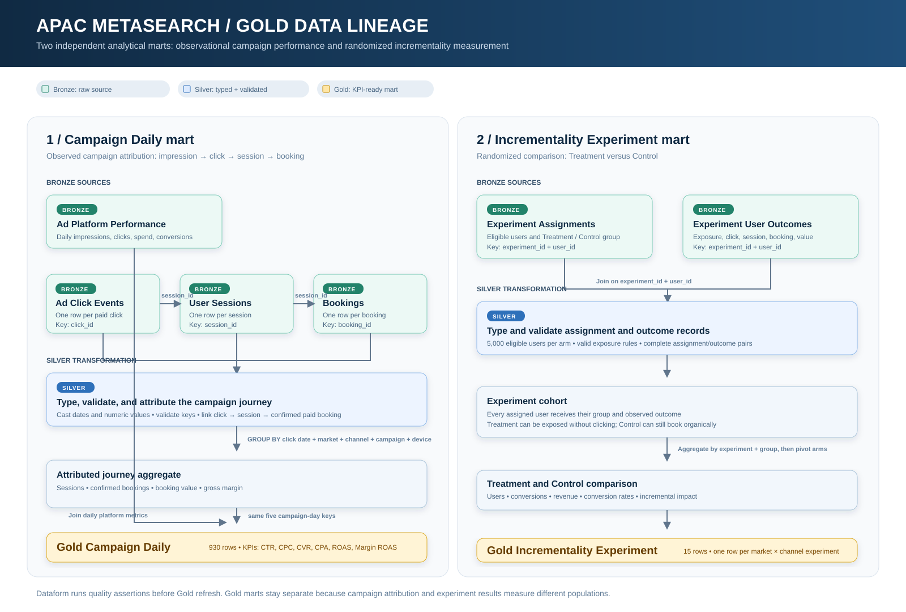

# Data model and measurement logic

[Project overview](../README.md) · [Power BI report](report.md) · [Runbook and progress](operations.md)

## Business journey and table grain

The campaign analysis follows an impression through an ad click, a first-party session, and a confirmed paid booking. The experiment uses a separate eligible-user population to estimate demand caused by advertising. All records are synthetic USD equivalents for August 2026.

| # | Source CSV and grain | Key and join | Why it exists |
|---:|---|---|---|
| 1 | [Ad platform performance](../data/ad_platform_performance.csv): date × market × channel × campaign × device | Match clicks at the same reporting grain | Impressions, clicks, ad spend, and platform conversions. |
| 2 | [Ad click events](../data/ad_click_events.csv): one click | `click_id`; optional `session_id` | Click-level journey and clicks that never become sessions. |
| 3 | [User sessions](../data/user_sessions.csv): one session | `session_id`; `user_id` | First-party visits, including paid and organic traffic. |
| 4 | [Bookings](../data/bookings.csv): one booking | `booking_id`; `session_id` | Status, payment, booking value, commission, and realized gross margin. |
| 5 | [Experiment assignments](../data/experiment_assignments.csv): experiment × eligible user | `experiment_id` + `user_id` | Random Treatment or Control assignment and the experiment denominator. |
| 6 | [Experiment user outcomes](../data/experiment_user_outcomes.csv): experiment × user | `experiment_id` + `user_id`; optional click/session/booking IDs | Exposure, optional journey, and confirmed paid outcome. |

The generator covers Thailand (`TH`), Indonesia (`ID`), and Singapore (`SG`); Google Hotel Ads, Google Flights, Skyscanner, Trivago, and Wego; and mobile/desktop. `CMP001`–`CMP015` each represent one market and channel. The 15 experiments are the same 3 markets × 5 channels, with 5,000 assigned users in each arm.

### One traceable campaign booking

These rows are in the checked-in source CSV files. The click and booking connect through `session_id`.

| # | Source | Example fields |
|---:|---|---|
| 1 | Ad click event | `CLK0000045`; `CMP001`; `TH`; Google Hotel Ads; mobile; `SES0000040` |
| 2 | User session | `SES0000040`; `USR0000025`; `paid_metasearch`; starts 2026-08-01 10:43:00 |
| 3 | Booking | `BKG0000001`; `SES0000040`; confirmed and paid; USD 117.52 booking value; USD 17.63 gross margin |

The corresponding platform table is already aggregated by date, market, channel, campaign, and device. It does not contain this booking ID.

## Lineage and quality gate



| # | Layer | Transformation and output |
|---:|---|---|
| 1 | Bronze | Load the six source-shaped CSV tables into BigQuery; check schema and row counts. |
| 2 | Silver | Cast source fields to dates, timestamps, and numbers; standardize statuses; preserve unmatched clicks and organic sessions; validate keys, references, ranges, timing, experiment arms, and cross-table reconciliation. |
| 3 | Gold Campaign Daily | Join and aggregate campaign, click, session, and booking data to click date × market × channel × campaign × device. |
| 4 | Gold Incrementality Experiment | Join assignments to outcomes on `experiment_id` + `user_id`, then aggregate Treatment and Control results to one row per experiment. |

[Dataform SQLX definitions](../dataform/definitions/) implement the transformations. The two Gold actions explicitly depend on relevant upstream assertions, so a failing upstream quality check skips that Gold rebuild and retains the last successful table. Gold's own output assertions run after materialization and check the resulting mart. The latest successful workflow ran 31 actions, including 23 assertion actions. The source CSV load occurs before Dataform and is not part of those 31 actions.

### Campaign attribution

Join a click to its session on `session_id`, then join a booking to that session. Count only `booking_status = 'confirmed'` and `payment_status = 'paid'` as realized conversions, value, and margin. Attribute those bookings to the **click date**; a booking can occur up to 72 hours after its session. Aggregate click and booking facts to the platform row grain before combining them with impressions or spend, or the join would multiply platform metrics.

The source generator permits a click with no session, an organic session, and multiple sessions or bookings for one user. `traffic_source` belongs to a session, not permanently to a user. In this demo, a session has at most one generated booking. Hotel, flight, and activity use different fixed commission rates (15%, 7%, and 19%); destination does not change the rate. Cancelled and pending bookings have zero realized margin.

### Experiment calculation

```text
experiment_assignments (experiment_id, user_id, assigned group)
    → left join experiment_user_outcomes on experiment_id + user_id
    → aggregate by experiment_id + group
    → gold_incrementality_experiment
```

Every assigned user stays in the denominator. A Treatment user may have no test-ad click; a Control user may book through an organic or direct session. A click ID is journey evidence, not the experiment join key or causal denominator. The experiment population is isolated from observational campaign attribution, so its bookings and revenue must not be added to campaign totals.

For example, assignment `EXP-TH-01` + `EXPUSR0000167` is in Treatment. Its outcome row records a test-ad exposure and click (`EXPCLK0000026`), session `EXPSES0000064`, and confirmed paid booking `EXPBKG0000009` for USD 129.88. Both rows join on the experiment and user IDs; the click and session IDs describe this one user's journey.

## Key performance indicators

| # | KPI: abbreviation and full name | Definition |
|---:|---|---|
| 1 | CTR — Click-through rate | `clicks / impressions` |
| 2 | CPC — Cost per click | `ad_spend / clicks` |
| 3 | CVR — Click-to-booking conversion rate | Confirmed paid `conversions / clicks` |
| 4 | CPA — Cost per acquisition | `ad_spend / confirmed paid conversions` |
| 5 | ROAS — Return on ad spend | Confirmed paid `booking_value / ad_spend` |
| 6 | Margin ROAS — Gross margin return on ad spend | Confirmed paid `gross_margin / ad_spend` |
| 7 | Booking per session | Confirmed paid `bookings / attributed sessions` |
| 8 | Incremental conversions | `Treatment eligible users × (Treatment conversion rate − Control conversion rate)` |
| 9 | CVR difference — Conversion rate difference | `Treatment conversion rate − Control conversion rate`, reported in percentage points |
| 10 | 95% CI — 95% confidence interval for the difference | Difference `± 1.96 × √(pT(1−pT)/nT + pC(1−pC)/nC)`; two-sided normal approximation |

`gross_margin` is booking value × commission rate before ad spend. Contribution after ad spend is gross margin minus ad spend. Power BI DAX measures divide aggregated numerators by aggregated denominators after filtering; daily rates are not averaged.

## Designed patterns and limits

Indonesia has the largest traffic and lower cost per click. Singapore has less traffic, higher cost per click, and higher booking value. Mobile has higher click-through rate and slightly lower session conversion propensity than desktop. `CMP003` intentionally has high click-through rate and low conversion rate for investigation.

The experiment is a synthetic randomized scenario. Incremental revenue is gross booking value from its separate population, not campaign margin or incremental return on ad spend. The displayed 95% interval assumes independent Bernoulli observations and does not adjust for multiple comparisons. There is one month of generated data and no live ad feed.
